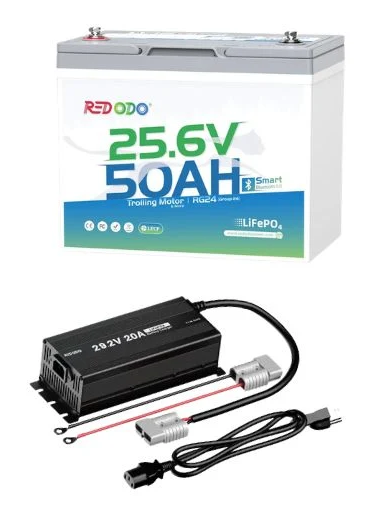

## Maintenance 
- Periodically inspect the pull rope, including the stopper knots at each end, the handle for cracks, the pad eyes for cracks and tightness, the pulleys on the cleat and motor mount, the rope for fraying, and the latch.
- Check the motor mount bolts for tightness
- Check the motor pivot knobs for cracks or damage
- Check the power cable for wear, the cable connector for corrosion or bent sockets, and the connector cover for damage and fit tightness 
- Check the propeller anodes ([link](https://www8.garmin.com/manuals/webhelp/GUID-91136105-7EB2-442E-8C25-7B4CF00FC466/EN-US/GUID-FB7CA353-53BA-41F2-9743-4F47459C2AA2.html)) and replace if necessary 
- Re-torque the propeller nut to 12 ft-lb
- Check the screws securing the pedal rails to the kayak and tighten if necessary
- Check the battery compartment in the foot pedals for corrosion and clean the contacts if necessary 

After any salt/brackish-water use, rinse the motor with fresh water and wipe on water-based silicone spray.

## Components

[Power Steer Foot Pedals](https://www.garmin.com/en-US/p/pn/010-13307-00/):

[Bonafide RVR119 Stern Motor Mount](https://bonafidefishing.com/products/stern-motoranchor-mount-rvr?pr_prod_strat=e5_desc&pr_rec_id=1f1321c75&pr_rec_pid=7522817736894&pr_ref_pid=7906896937150&pr_seq=uniform):

[Redodo 24V 50Ah Bluetooth Lithium Trolling Motor Battery](https://www.redodopower.com/products/redodo-24v-50ah-trolling-motor-battery-with-bluetooth?_pos=5&_psq=24&_psid=0039eb3a0&_ss=e&variant=43816549384282):

